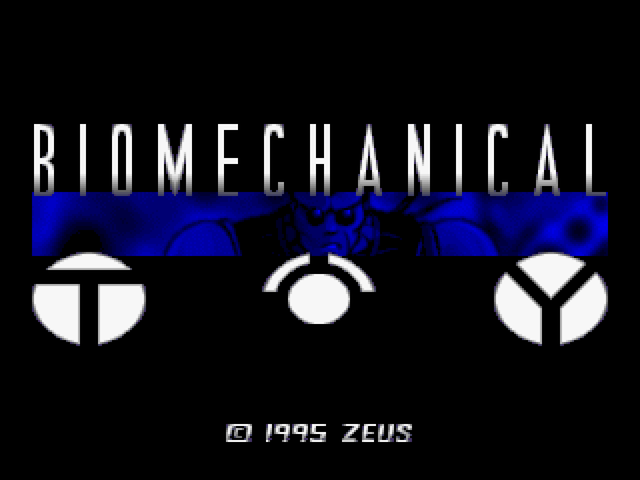
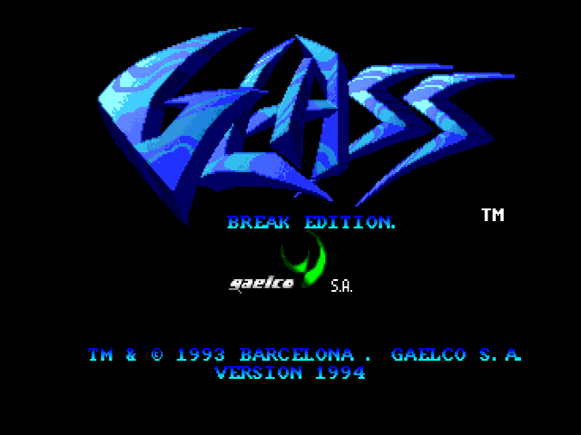
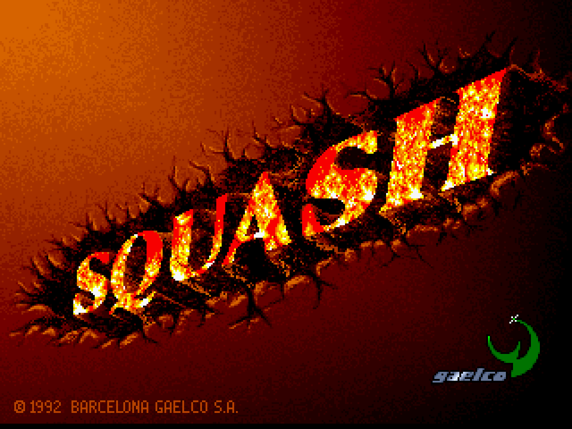
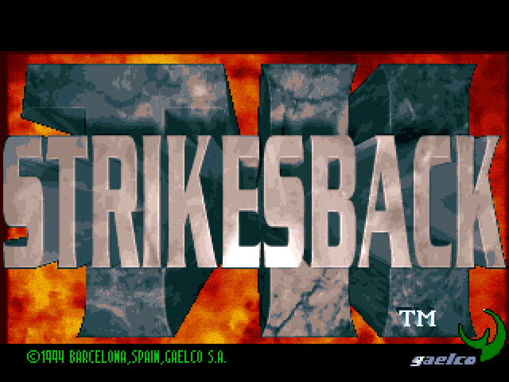
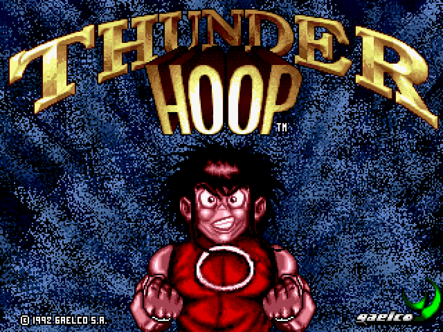

# gaelco-fpga

Gaelco arcade cores for **MiSTer**. · Cores arcade de **Gaelco** para **MiSTer**.

<!-- MOSAICO:AUTO -->

## Horizontal

<table>
<tr>
<td align="center" width="33%"><a href="DETAILS.md#alligator-hunt-gaelco-1994"></a><br><b>Alligator Hunt</b> · 1994</td>
<td align="center" width="33%"><a href="DETAILS.md#big-karnak-gaelco-1991"></a><br><b>Big Karnak</b> · 1991</td>
<td align="center" width="33%"><a href="DETAILS.md#biomechanical-toy-gaelco-199495--beta"></a><br><b>Biomechanical Toy</b> · 1995</td>
</tr>
<tr>
<td align="center" width="33%"><a href="DETAILS.md#glass-gaelco-1993"></a><br><b>Glass</b> · 1993</td>
<td align="center" width="33%"><a href="DETAILS.md#squash-gaelco-1992--beta"></a><br><b>Squash</b> · 1992</td>
<td align="center" width="33%"><a href="DETAILS.md#th-strikes-back--thunder-hoop-2-gaelco-1994--beta"></a><br><b>TH Strikes Back</b> · 1994</td>
</tr>
<tr>
<td align="center" width="33%"><a href="DETAILS.md#thunder-hoop-gaelco-1992--beta"></a><br><b>Thunder Hoop</b> · 1992</td>
<td align="center" width="33%"><a href="DETAILS.md#world-rally-2-twin-racing-gaelco-1995"></a><br><b>World Rally 2</b> · 1995</td>
<td align="center" width="33%"><a href="DETAILS.md#world-rally-gaelco-1993"></a><br><b>World Rally Championship</b> · 1993</td>
</tr>
</table>

<!-- /MOSAICO:AUTO -->

<!-- INSTALAR:AUTO -->

## How to install the Gaelco cores on your MiSTer FPGA

Two options:

1. **Download and copy them yourself.** The `.rbf` cores are in [`releases/`](releases/) and go to `_Arcade/cores/` on
   the SD card; the `.mra` files are in `cores/<core>/mra/` and go to `_Arcade/`.
2. **Let the MiSTer Downloader do it.** Add the [jlrh-misterfpga-db](https://github.com/jlrh/jlrh-misterfpga-db)
   database to `downloader.ini` (root of the SD card) and run `Scripts → update`. It installs these cores **and the
   rest of jlrh's arcade cores** (Konami, Seibu, Inder, Cidelsa…), and keeps them all up to date.

```ini
[jlrh/jlrh-misterfpga-db]
db_url = https://raw.githubusercontent.com/jlrh/jlrh-misterfpga-db/db/db.json.zip
```

**ROMs are not included.** Bring your own MAME romsets (merged, MAME 0.288) into `games/mame/`. The exact set each core
expects is in [`ROMS.md`](https://github.com/jlrh/jlrh-misterfpga-db/blob/main/ROMS.md).

**More:** build instructions in [`BUILD.md`](BUILD.md); hardware, status, controls and credits of each core in
[`DETAILS.md`](DETAILS.md). Screenshots taken from MAME.

Built on the GPLv3 **JTFRAME** framework. Independent project — **not** an official jotego core. License: GPLv3
([`LICENSE`](LICENSE)).

## Cómo instalar los cores de Gaelco en tu MiSTer FPGA

Dos opciones:

1. **Descargarlos y copiarlos tú.** Los `.rbf` están en [`releases/`](releases/) y van a `_Arcade/cores/` en la SD;
   los `.mra` están en `cores/<core>/mra/` y van a `_Arcade/`.
2. **Que lo haga el MiSTer Downloader.** Añade la base de datos
   [jlrh-misterfpga-db](https://github.com/jlrh/jlrh-misterfpga-db) a `downloader.ini` (en la raíz de la SD) y ejecuta
   `Scripts → update`. Instala estos cores **y el resto de cores arcade de jlrh** (Konami, Seibu, Inder, Cidelsa…), y los
   mantiene todos al día.

```ini
[jlrh/jlrh-misterfpga-db]
db_url = https://raw.githubusercontent.com/jlrh/jlrh-misterfpga-db/db/db.json.zip
```

**Las ROMs no se incluyen.** Pon tus propios romsets de MAME (merged, MAME 0.288) en `games/mame/`. El set exacto que
espera cada core está en [`ROMS.md`](https://github.com/jlrh/jlrh-misterfpga-db/blob/main/ROMS.md).

**Más:** cómo compilar, en [`BUILD.md`](BUILD.md); hardware, estado, controles y créditos de cada core, en
[`DETAILS.md`](DETAILS.md). Capturas tomadas de MAME.

Hechos sobre el framework **JTFRAME** (GPLv3). Proyecto independiente — **no** es un core oficial de jotego. Licencia:
GPLv3 ([`LICENSE`](LICENSE)).

<!-- /INSTALAR:AUTO -->
